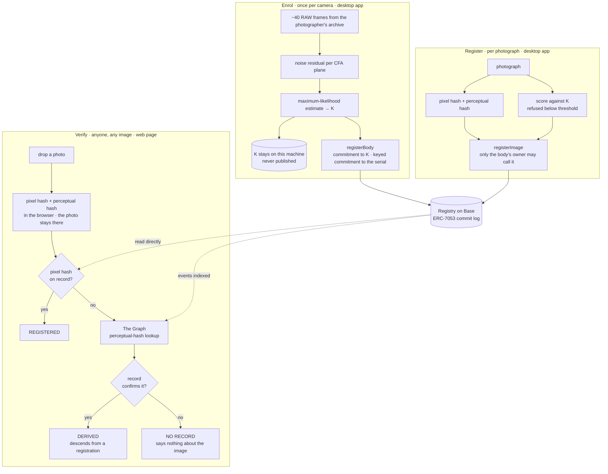

  <picture>
    <source media="(prefers-color-scheme: dark)" srcset="logos/genesis-lockup-horizontal-white.png">
    
  </picture>

**Register your photographs against the camera that took them, and let anyone
check a copy that has already left.**

Colosseum · Crypto World's Fair 2026 · built on Base · rehearsed on Base
Sepolia, **live on Base mainnet**

---

## Check a photograph now

1. Open **<https://muse254.github.io/genesis/verify/>**.
2. Drop a JPEG, PNG or TIFF on it. RAW files are refused in the browser;
   the desktop app checks those.
3. Read the verdict.

The photo does not leave your browser. The page decodes it and computes two
hashes locally (WASM), then sends only those: the pixel hash to the registry
on chain, and the perceptual hash to The Graph. Nothing is uploaded.

| Verdict | What it means |
| --- | --- |
| **Registered by the body's owner** | These exact pixels were registered by the key that owns a camera body, at the time shown. |
| **Descends from a registered photograph** | A resized, stripped or re-encoded copy. The perceptual hash found a registration and the chain confirmed it. |
| **No record** | Nothing on the registry matches. That says nothing about the image: not that it is fake, not that it is generated. |

**Today the page reads the Base Sepolia test registry**, which holds only
rehearsal registrations, so almost any photo you try will come back as *No
record*, which is the correct answer. On that registry the page also warns,
on every verdict, that the registration time cannot be relied on (see
[Deployments](#deployments)). Photographs registered on Base mainnet will be
linked here once they exist.

## What Genesis claims, and what it does not

**We certify two things and nothing else:**

1. body X's **owner** registered this image at time T, and
2. these pixels correlate with body X's sensor fingerprint at PCE *p*.

Never the second alone. **Read [`docs/adversarial.md`](docs/adversarial.md)
before trusting either.** We attacked our own system: anyone holding one RAW
file off a camera can plant its fingerprint in an image that camera never
took, invisibly (57 dB PSNR). With the fingerprint itself, a forgery scores
PCE 116 against a threshold of 100 at 73 dB, where a genuine delivered JPEG
scores 1,148. That document has every number, and the three we corrected
after re-measuring.

So the owner's registration carries the claim, not the fingerprint. The one
check no attack got past is the contract's: only the key that owns a body can
register an image to it ([`docs/security.md`](docs/security.md)).

What Genesis does not say, and why ([`docs/claims.md`](docs/claims.md)):

- never "authentic", "AI-free" or "verified real";
- never that a missing record means anything;
- a PCE score is strength of evidence, not a verdict. There is no measured
  false-positive rate across a population of cameras, and no established rate
  for telling a genuine frame from a forged one;
- a camera pointed at a good screen takes a genuine exposure of a fabricated
  scene. That defeats every provenance system, in-camera signing included;
- phone photographs are outside its scope ([`docs/phones.md`](docs/phones.md)).

## Why

AI-generated images now pass for photographs, and the industry's answer,
signing inside the camera, exists on a handful of flagship bodies and covers
nothing already shot. The photo world is trying to prove a negative: that an
image *wasn't* generated. Genesis records a positive instead.

Every image sensor has a permanent, per-body noise pattern (PRNU) that is
imprinted on every exposure. Genesis learns it from about 40 RAW files a
photographer already has, on their own machine, and lets them register their
photographs on a public record under their own key. Later, anyone can check
whether a copy (stripped, resized, re-posted) traces back to one of those
registrations.

It works on the camera the photographer already owns. PRNU covers the archive
that exists; in-camera signing (C2PA) covers what is shot from now on.

## Deployments

| | Address | Status |
| --- | --- | --- |
| **Base mainnet** registry | [`0xBa5Ea549c9e1414C14038dB050e0caCB4f9E48cB`](https://basescan.org/address/0xBa5Ea549c9e1414C14038dB050e0caCB4f9E48cB) | Live since 12 Oct 2026, block 52505470 ([deploy tx](https://basescan.org/tx/0x24d5f952de05e5280406923be51c281dd1b1feb5bf174141ee079d90e4da6582)). `testMode` false, `VERSION` 1.0.0, verified on Basescan. Subgraph and verify page move here next |
| Base Sepolia test registry | [`0x0C0F3Ec87339F985c509c01dEE8474BB8f5b0EB2`](https://sepolia.basescan.org/address/0x0c0f3ec87339f985c509c01dee8474bb8f5b0eb2) | Live; what the verify page reads today. Subgraph `genesis` v0.1.0-base-sepolia |
| Ethereum Sepolia (ETHOnline) | `0xd1bbDB8A6BfD25563d2e6444fA41E4C5230Ed3C9` | Historical; no longer used |

The Base Sepolia registry is a **test** registry: `testMode` is true, so its
administrator can wipe every record. A date on it is not a date anyone should
rely on. The mainnet registry is deployed with `testMode` false, and the
contract refuses the flag outside a testnet. Anyone assessing a registration
should read `testMode()` on the registry first.

## How it works

**Enrol.** The desktop app reads the RAW files, extracts each frame's noise
residual and estimates the fingerprint, K. Only a hash of K goes on the
record; K itself never leaves the machine, because a published fingerprint is
a forgery kit. The photographer can also commit, under their own key, to the
camera's make, model and serial, which they reveal only if a claim is ever
disputed.

**Register.** Each photograph is scored against K and refused if the pixels do
not support it. Otherwise its pixel hash, perceptual hash and a dated record go
on the registry, which accepts it only from the key that owns the camera.

**Verify.** An exact pixel hash means this is the registered file. A resized
or re-encoded copy has a different hash, so the perceptual hash finds the
original through The Graph, and the registry confirms it before anything is
shown. The web page and the desktop app run the same verification,
[`core/`](core/): Rust compiled to WASM for the pixel work, TypeScript for the
chain and the verdict ([`docs/shared-verify-plan.md`](docs/shared-verify-plan.md)).
The desktop app adds a fingerprint score against its owner's K.

Where K lives, what the stored score does and does not mean, and why scoring
in the cloud or with a proof is future work:
[`docs/security.md`](docs/security.md).

## The desktop app

Enrolment and registration need the RAW archive and K, so they run on the
photographer's machine, in a desktop app (Tauri, with the Python imaging code
embedded). Downloads are on the landing page,
<https://muse254.github.io/genesis/>, which lists the latest published
release. **No release has been published yet**; installers will be unsigned
at first, with instructions on that page. To build it yourself, see
[`desktop/README.md`](desktop/README.md).

If you already have a fingerprint file, <https://muse254.github.io/genesis/score/>
scores a photograph against it entirely in the browser; neither file is sent
anywhere ([`score/README.md`](score/README.md)).

## Repository

| Path | What it is |
| --- | --- |
| [`core/`](core/) | The one verification implementation, shared by the web page and the desktop app (TypeScript + WASM; JPEG via libjpeg-turbo). `core/raw/` is LibRaw in WASM, for enrolment in the browser |
| [`rust/`](rust/) | `genesis-prnu`: noise residual, PCE, scoring, hashes; `genesis-prnu-wasm`: its WASM build |
| [`fingerprint/`](fingerprint/) | Python: enrolment, the PRNU estimator and scorer, the attacks in `docs/adversarial.md` |
| [`ingest/`](ingest/) | Python: pixel and perceptual hashing, records, commitments |
| [`contracts/`](contracts/) | Solidity + Foundry: `Registry.sol`, ERC-7053 commit log and body registry |
| [`subgraph/`](subgraph/) | The Graph: indexes registrations, resolves a perceptual hash to a record |
| [`verify/`](verify/) | The public verify page |
| [`score/`](score/) | Local, in-browser scoring against your own K |
| [`dashboard/`](dashboard/) | No-login view of any address's bodies and images, from the subgraph |
| [`site/`](site/) | Landing and download page |
| [`console/`](console/), [`console-ui/`](console-ui/), [`desktop/`](desktop/) | The photographer's app: local backend, its UI, and the Tauri shell |
| [`scoring/`](scoring/) | HTTP scoring service; no longer used by the verify page |
| [`mcp/`](mcp/) | MCP server over the subgraph, for agents |
| [`docs/`](docs/) | Claims, security, the adversarial work, measurements, plans |

## The maths

A sensor's photosites differ slightly in how much charge each returns for the
same light. That gain error, K, is fixed at manufacture and multiplies the
signal. Genesis estimates it by maximum likelihood over the enrolment frames
and verifies with Peak to Correlation Energy (PCE).

- [`docs/camera-sensors.md`](docs/camera-sensors.md): the physics, with
  references
- [`fingerprint/prnu.py`](fingerprint/prnu.py): the implementation, citing
  equations by number
- J. Fridrich, [*Digital Image Forensics Using Sensor
  Noise*](http://ws2.binghamton.edu/fridrich/Research/full_paper_02.pdf), IEEE
  Signal Processing Magazine 26(2), 2009: sensor model eq. (3), estimator
  eq. (6), variance eq. (7), PCE eq. (14)
- [`docs/gates.md`](docs/gates.md): measured on a real Canon R10, including
  what survives the web

## For developers

[`BUILD.md`](BUILD.md) is the full design: architecture, toolchain, and the
reasoning behind each choice. [`COLOSSEUM.md`](COLOSSEUM.md) is the current
plan and [`docs/colosseum-checklist.md`](docs/colosseum-checklist.md) what is
done. The enrolment frames and fingerprints used for the measurements are
deliberately not in this repository ([`docs/claims.md`](docs/claims.md), "Why
the test files are not published"); everything regenerates from your own
camera.

## Licence

**Not yet chosen.** Until a licence is added, no rights are granted beyond
reading the code here. Whatever is chosen has to be compatible with shipping
LibRaw (LGPL 2.1 / CDDL 1.0) in the WASM build.

---

Built for ETHOnline 2026; that submission is preserved at the
[`ethonline-submission`](../../tree/ethonline-submission) tag, pinned to
commit [`1e2f392`](../../tree/1e2f392) so it stays reachable even if the tag
ever moves.
